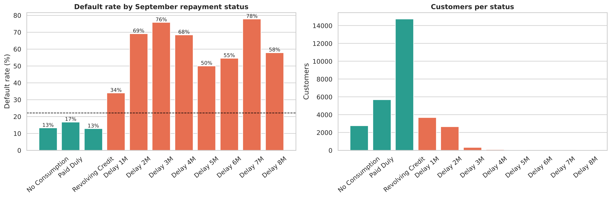
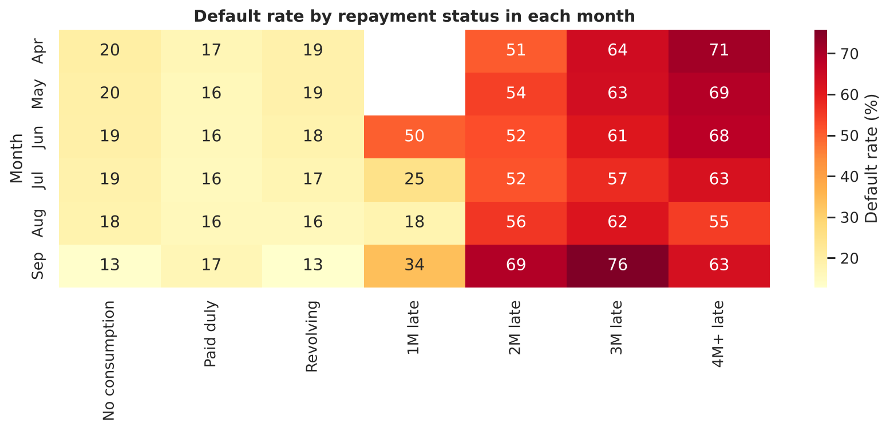
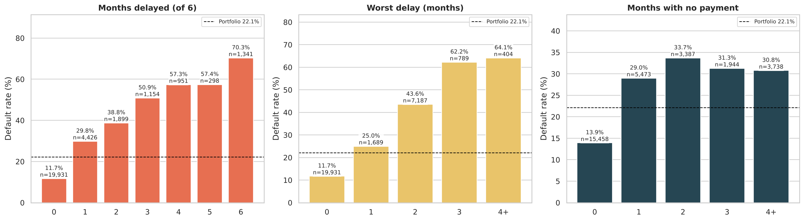
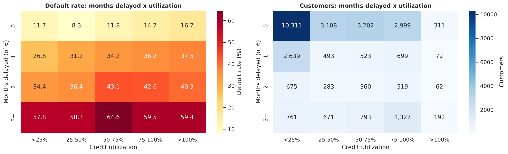
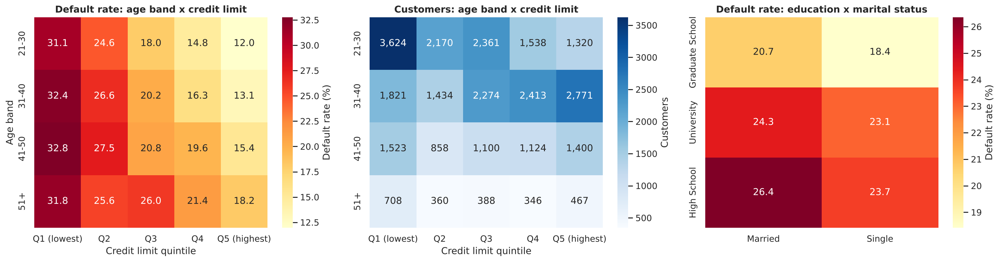
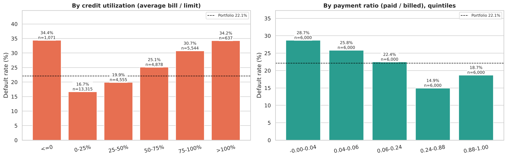
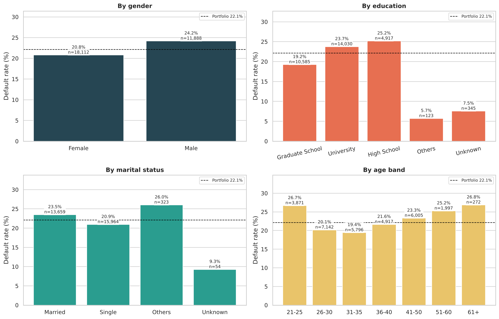
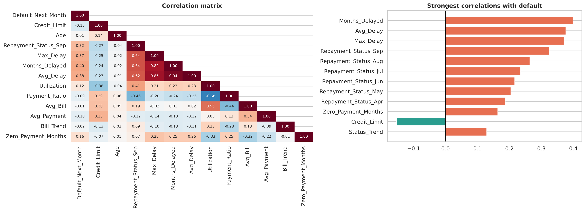

# CreditLens-Banking-Credit-Risk-Analytics
<h1 align="center">Credit Card Default Risk</h1>
<h3 align="center">Exploratory Data Analysis of Repayment Behaviour</h3>

<p align="center">
  
  
  
  
  
</p>

<p align="center">
  <i>What do six months of repayment history tell us about which of 30,000 credit card customers will default next month?</i>
</p>

<p align="center"><b>Author: Habiba</b></p>

---

## Table of contents

1. [Overview](#overview)
2. [Key results at a glance](#key-results-at-a-glance)
3. [Repository structure](#repository-structure)
4. [Dataset](#dataset)
5. [Getting started](#getting-started)
6. [What the code does](#what-the-code-does)
7. [Exploratory analysis: how and why](#exploratory-analysis-how-and-why)
8. [Key insights](#key-insights)
9. [Recommendations](#recommendations)
10. [Limitations](#limitations)
11. [Tech stack](#tech-stack)
12. [Data source and citation](#data-source-and-citation)

---

## Overview

A bank that issues credit cards wants to know **who is likely to miss next month's payment, and what warning signs appear beforehand.** This project answers that with a complete exploratory data analysis (EDA) of 30,000 customers, covering April to September 2005.

The work follows the path an analyst would take on a real portfolio:

1. **Prepare the data**: load it, give every column a readable name, audit quality, decode categories, review outliers.
2. **Engineer behavioural measures**: condense six months of history into a handful of interpretable indicators (delay, utilization, repayment effort).
3. **Explore systematically**: compare default rates across demographics, credit limits, repayment history, utilization and combinations of these, with statistical checks and 15 charts built in `matplotlib` and `seaborn`.
4. **Translate findings into actions**: a delay-history segmentation and seven recommendations, each tied to evidence.

> **Headline finding:** repayment behaviour, not demographics, explains who defaults. A customer who is two months late has a **69%** chance of defaulting next month, against **14%** for a customer who is current. 52% of all defaulters were already late the month before.

The analysis is **descriptive**: it explains patterns in the data and does not build a predictive model.

<p align="center">
  
</p>

---

## Key results at a glance

| Metric | Result |
|---|---|
| Customers analysed | **30,000** (24 variables plus an ID) |
| Overall default rate | **22.1%** (6,636 customers) |
| Default rate: current / 1 month late / 2 months late | **13.8%** / **33.9%** / **69.1%** |
| Defaulters who were already late the month before | **52%** |
| Customers never late in six months | **66%**, of whom only **11.7%** default |
| Customers with at least one late month | **33.6%** of the portfolio, holding **65%** of all defaults |
| Default rate, lowest vs highest credit-limit quintile | **31.8%** vs **13.8%** |
| Default rate at 0-25% vs 75-100% utilization | **16.7%** vs **30.7%** |
| Strength of demographic effects (Cramér's V) | **0.07 or less** for gender, education and marital status |

---

## Repository structure

```text
credit-card-default-eda/
├── Credit_Default_EDA.ipynb              # the analysis: 19 code cells, one step per cell
├── reports/
│   └── Credit_Card_Default_EDA_Report.pdf  # 22-slide management report
├── figures/                              # 15 charts exported by the notebook
│   ├── 01_outliers.png
│   ├── 02_target.png
│   ├── ...
│   └── 15_correlations.png
├── data/
│   └── README.md                         # where to download the dataset (file not included)
├── requirements.txt
└── README.md
```

---

## Dataset

| | |
|---|---|
| **Name** | Default of Credit Card Clients |
| **Source** | [UCI Machine Learning Repository](https://archive.ics.uci.edu/dataset/350/default+of+credit+card+clients) |
| **Population** | 30,000 credit card customers in Taiwan |
| **Period** | April to September 2005 (six monthly cycles) |
| **Target** | `default payment next month` (1 = defaulted, 0 = did not) |
| **Quality** | No missing values, no duplicate rows or IDs |

The raw file is not stored in this repository. Download `default of credit card clients.xls` from the link above and place it in `data/` (or upload it to Google Colab).

<details>
<summary><b>Data dictionary (click to expand)</b></summary>

| Original column | Renamed to | Description |
|---|---|---|
| `ID` | `Customer_ID` | Customer identifier |
| `LIMIT_BAL` | `Credit_Limit` | Credit limit in NT dollars (individual plus family credit) |
| `SEX` | `Gender` | 1 = male, 2 = female |
| `EDUCATION` | `Education_Level` | 1 = graduate school, 2 = university, 3 = high school, 4 = others (0, 5, 6 undocumented) |
| `MARRIAGE` | `Marital_Status` | 1 = married, 2 = single, 3 = others (0 undocumented) |
| `AGE` | `Age` | Age in years |
| `PAY_0`, `PAY_2` ... `PAY_6` | `Repayment_Status_Sep` ... `_Apr` | -1 = paid duly, 1-9 = months of delay (-2 and 0 undocumented) |
| `BILL_AMT1` ... `BILL_AMT6` | `Bill_Amount_Sep` ... `_Apr` | Monthly bill statement in NT dollars |
| `PAY_AMT1` ... `PAY_AMT6` | `Payment_Amount_Sep` ... `_Apr` | Amount paid that month in NT dollars |
| `default payment next month` | `Default_Next_Month` | Target variable |

The source names September `PAY_0` and has no `PAY_1`; renaming every column with its month removes that trap.

</details>

---

## Getting started

### Google Colab (recommended)

1. Open `Credit_Default_EDA.ipynb` in Colab.
2. Upload the dataset file to the session (Files panel on the left).
3. In **cell 2**, set `DATA_PATH` to the file's path (right-click the file, *Copy path*).
4. Run the cells from top to bottom. Charts are saved to a `figures/` folder.

### Local

```bash
git clone https://github.com/<your-username>/credit-card-default-eda.git
cd credit-card-default-eda
pip install -r requirements.txt
jupyter notebook Credit_Default_EDA.ipynb
```

Set `DATA_PATH` in cell 2 to `data/default of credit card clients.xls`.

---

## What the code does

The notebook has 20 numbered sections. Each is one cell followed by a short note stating its main finding.

### 1. Setup and loading (sections 1-2)
- Imports `pandas`, `numpy`, `matplotlib`, `seaborn` and `scipy`, and defines one colour palette and a few helpers (`save`, `pct`, `rate_bar`) so every chart looks consistent.
- Reads the Excel file (the real header is on row 2) and **renames all 24 columns** with descriptive names that include the month.
- Builds column lists per month in chronological order (`STATUS`, `BILL`, `PAY`) so later code can loop over them.

### 2. Data audit and decoded labels (section 3)
- Checks rows, columns, missing values, duplicate rows and duplicate IDs: the file is structurally clean.
- Finds the real quality problem: **undocumented category codes** (345 customers with education codes 0, 5 or 6; 54 with marital code 0).
- Keeps two versions of the data: `raw` with numeric codes, and `df` with readable labels for charts.

### 3. Outlier review (section 4)
- Screens all 14 monetary and age columns with the **1.5 x IQR rule** and draws boxplots.
- Investigates negative bills and accounts that were billed nothing for six months.
- **Decision:** no records are removed. Long right tails are normal for spending data, and negative bills are legitimate credit balances.

### 4. Feature engineering (section 5)
Six months of raw columns are condensed into measures a credit officer would recognise:

| Measure | Definition | No default | Default |
|---|---|---|---|
| `Months_Delayed` | Months (of 6) paid late | 0.50 | 2.00 |
| `Max_Delay` | Worst delay, in months | 0.47 | 1.43 |
| `Avg_Delay` | Mean delay across six months | 0.16 | 0.71 |
| `Zero_Payment_Months` | Months with no payment at all | 1.08 | 1.76 |
| `Utilization` | Average bill / credit limit | 0.35 | 0.45 |
| `Payment_Ratio` | Total paid / total billed (0 to 1) | 0.37 | 0.28 |

Also created: `Avg_Bill`, `Avg_Payment`, `Bill_Trend` and `Status_Trend`. Unknown education and marital codes are merged into "Others" in these derived columns.

### 5. Exploratory analysis and recommendations (sections 6-20)
Fourteen analysis steps (next section), then a written set of recommendations.

---

## Exploratory analysis: how and why

| # | Analysis | Technique | Question it answers |
|---|---|---|---|
| 6 | Target distribution | Bar chart | How common is default, and how should results be judged? |
| 7 | Customer profile | Histograms, count plots, boxplot | Who are the customers? |
| 8 | Demographics | Default rate per group, chi-square test, Cramér's V | Do gender, education, marital status or age matter, and how much? |
| 9 | Age x limit x education x marital | Cross-tab heatmaps | Do effects hold once a second factor is held constant? |
| 10 | Repayment status | Default rate per status | Is the latest repayment status a warning sign? |
| 11 | Delay in every month | Month x status heatmap | Does delay matter only recently, or at any point? |
| 12 | Delay history and segments | Rate by months late; segmentation table | Can customers be grouped by delay history? |
| 13 | Utilization and payment ratio | Default rate by bucket | Does heavy credit use or low repayment raise risk? |
| 14 | Delay x utilization | Two-factor heatmap | Which matters more, delay history or utilization? |
| 15 | Bills and payments over time | Line charts by outcome | Do defaulters spend more or pay less? |
| 16 | Distributions by outcome | Violin plots | How do behaviours differ between the groups? |
| 17 | Bills, payments, utilization | Scatter plots | How do these variables move together? |
| 18 | Pairwise relationships | Pair plot | Which variables separate the outcomes? |
| 19 | Correlations | Correlation matrix, ranked bars | Which measures are most strongly linked to default? |

**Why this design.** Overall averages hide the story, so almost every chart shows the *default rate within a group*, annotated with group size (`n`) so small groups are not over-read. Because 30,000 rows make tiny differences "statistically significant", effect sizes (Cramér's V) are reported next to p-values. Cross-tab heatmaps are used to separate overlapping effects, for example age versus credit limit.

---

## Key insights

### 1. The warning window is short
Default climbs from **13.8%** for customers who are current to **33.9%** after one month late and **69.1%** after two. About 10% of customers are two or more months late, and roughly seven in ten of them default. **52% of all defaulters were already late the month before**, so the first one or two months of delay form the practical early-warning window.

### 2. Delay is a warning sign in every month, not only the latest
Being two or more months late is associated with a **51% to 76%** default rate in every one of the six months.

<p align="center">
  
</p>

### 3. Risk rises with every additional late month
Two thirds of customers (66%) were never late and only 11.7% of them default. Default is 29.8% after one late month, 50.9% after three, and 70.3% when all six months were late.

| Segment | Share of customers | Default rate | Share of all defaults |
|---|---|---|---|
| Never late | 66.4% | 11.7% | 35.2% |
| 1 month late | 14.8% | 29.8% | 19.9% |
| 2 months late | 6.3% | 38.8% | 11.1% |
| 3+ months late | 12.5% | 60.0% | 33.8% |

The 3+ group is an eighth of the portfolio but holds a third of all defaults. Customers with *any* late month hold 65%.

<p align="center">
  
</p>

### 4. Delay history outweighs utilization
Customers who were never late default at 8% to 17% at **every** utilization level, and customers late in three or more months default at 58% to 65% at every level. Utilization adds a moderate lift inside each group.

<p align="center">
  
</p>

### 5. Credit limit matters more than age
Default falls steadily as the limit rises, **31.8% in the lowest-limit quintile to 13.8% in the highest**, and the gradient holds in every age band. The higher default of the youngest customers is largely a limit effect: 3,624 of them sit in the lowest-limit quintile, and inside that quintile the gap by age is small.

<p align="center">
  
</p>

### 6. Heavy utilization and low repayment effort raise risk
Default is 16.7% at 0-25% utilization, 30.7% at 75-100% and 34.2% above the limit. Customers repaying under 6.5% of their bill default at 26% to 29%, against about 15% for those repaying 25% to 88%.

<p align="center">
  
</p>

### 7. Defaulters are not billed more; they pay less
In September the average bill is slightly *lower* for defaulters (48.5k vs 52.0k), but defaulters pay **40% to 50% less every month** (3.4k vs 6.3k). Among customers with an average bill above 50,000, the 5,657 who repay under 5% default at 23.8%, against 6.5% for the 630 who repay at least 25%.

### 8. Demographics differ significantly, but only slightly
| Group | Default rate | Cramér's V |
|---|---|---|
| Men vs women | 24.2% vs 20.8% | 0.04 |
| Education: Graduate School to High School | 19.2% to 25.2% | 0.07 |
| Married vs single | 23.5% vs 20.9% | 0.03 |

Age is U-shaped: 26.7% for ages 21-25, about 19% to 20% for 26-35, and 25% to 27% above 50.

<p align="center">
  
</p>

### 9. The strongest correlates of default are the engineered delay measures
Months delayed (0.40), average delay (0.38) and worst delay (0.37) lead, ahead of the raw September status (0.32). Credit limit is negatively correlated (-0.15) and age is essentially uncorrelated (0.01). The six monthly bills correlate 0.80 to 0.95 with one another, so they are summarised rather than used separately.

<p align="center">
  
</p>

### 10. Data quality flags
- **866 customers were billed nothing for six months, yet 541 are marked one month late** in September (default rate 36.6%). This needs the data owner's review.
- 1,930 customers (6.4%) have a negative bill (a credit balance) and default *less* (16.5% vs 22.5%).
- The code `1` (one month late) appears in 3,688 September records but in only 0, 0, 2, 4 and 28 records in the earlier months, a coding quirk of the source.

---

## Recommendations

| # | Recommendation | Evidence |
|---|---|---|
| 1 | **Intervene at the first missed payment.** Contact the customer (reminder, payment plan, due-date change) before a second month is missed. | Default is 13.8% when current, 33.9% after one month late, 69.1% after two. |
| 2 | **Manage customers in delay-history segments.** Never late: standard service and candidates for limit increases. One or two late months: reminders and payment plans. Three or more: collections and limit freezes. | Segments default at 11.7%, 29.8% to 38.8% and 60.0%; the 3+ group holds 34% of all defaults. |
| 3 | **Add utilization and repayment-effort alerts.** Alert at 75% utilization and on repeated near-zero payments. | Default is 16.7% below 25% utilization and 30.7% at 75-100%; customers repaying under 6.5% of bills default at 26% to 29%. |
| 4 | **Review limit policy.** Avoid limit increases for highly utilized or recently late customers; review the small-limit segment. | Default is 31.8% for limits of 50,000 or less against 13.8% in the top quintile, in every age band. |
| 5 | **Resolve the source-data questions.** Obtain a data dictionary for education, marital and repayment codes; investigate zero-bill accounts. | 866 zero-bill customers (541 marked late); 345 undocumented education codes; 54 marital codes. |
| 6 | **Keep demographics out of credit decisions.** Credit limit and repayment behaviour explain far more. | Cramér's V of 0.07 or less for gender, education and marital status. |
| 7 | **Re-run on current data before acting.** The notebook can be re-run on a fresh extract. | Single 2005 snapshot, no income data. |

---

## Limitations

- **Descriptive, not causal.** The analysis shows associations between behaviour and default, not what causes it.
- **One snapshot.** Six months from 2005, one market, and a one-month outcome window; thresholds should be re-validated on current data.
- **No income or employment data**, which a real credit assessment would include.
- **Partly undocumented codes.** Some category and repayment codes are not described by the source (see the data dictionary).

---

## Tech stack

| Purpose | Tools |
|---|---|
| Data handling | `pandas`, `numpy` |
| Visualisation | `matplotlib`, `seaborn` |
| Statistics | `scipy` (chi-square test, Cramér's V) |
| Environment | Jupyter Notebook / Google Colab |
| Reporting | 22-slide PDF in `reports/` |

---

## Data source and citation

Yeh, I-C. (2009). *Default of Credit Card Clients* [Dataset]. UCI Machine Learning Repository. https://doi.org/10.24432/C55S3H. Licensed under CC BY 4.0.

Related paper: Yeh, I-C. & Lien, C-H. (2009). The comparisons of data mining techniques for the predictive accuracy of probability of default of credit card clients. *Expert Systems with Applications*, 36(2), 2473-2480.

---

<p align="center">
  Created by <b>Habiba</b> as a data analysis portfolio project.<br>
  Feedback and suggestions are welcome via issues or pull requests.
</p>
